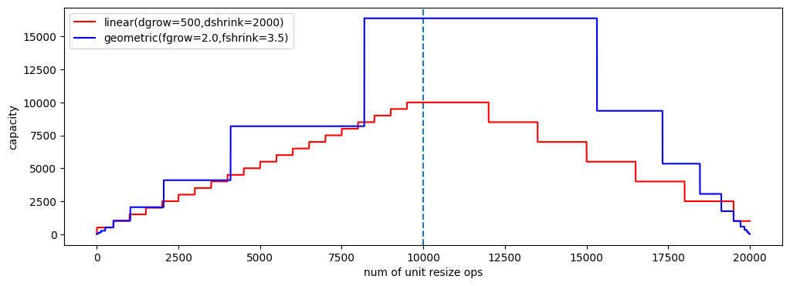

# Lab `dynamic-arrays`: array dinamici

1. **Implementazione C di array dinamici**: Studio e integrazione funzionalità
    - **Studiare** il sorgente `dynamic-arrays.c`, in particolare:
        - si compili (e.g. `gcc -Wall dynamic-arrays.c`) ed **esegua** il codice (e.g. `./a.out` o `.\a.exe` su Windows) e si cerchi di comprendere l'output; se l'output non torna, si noti che la funzione di `test` sfrutta funzioni **ancora da implementare**.
        - si noti l'uso di una rappresentazione stringa `[size/capacity]{ a_0, ..., a_{n-1} }` per gli array dinamici 
        - a questo punto si studi il sorgente, e si osservi le funzioni rilevanti, tra cui: `darray_create_capac`, `darray_print`, `darray_realloc`, `darray_resize_linear`, `darray_resize_geometric`
    - **Completare il sorgente implementando le seguenti funzioni**:
        - **`darray_append`**: atta ad aggiungere alla fine dell'array un elemento (ridimensionando l'array)
        - **`darray_insert`**: atta ad aggiungere alla posizione indicata un nuovo elemento (traslando opportunamente quelli attualmente presenti)
        - **`darray_assert_equals`**: atta a verificare con asserzioni che l'array dinamico indicato abbia lo stesso contenuto dell'array "tradizionale" fornito
        - **`darray_init(size, value)`**: che crea un nuovo array dinamico inizializzando i `size` elementi al valore `value`
    - Si noti la funzione di `test()` che viene invocata ed eseguita attivando le due modalità di espansione dell'array
    - Nota: si compili con `gcc -DDEBUG dynamic-arrays.c`, ovvero con opzione **`-DDEBUG`** per attivare log di debug e ispezionare il comportamento delle funzioni di riallocazione
2. *OPZIONALE.* Si consideri il notebook fornito **`plotting_darray_capacity_expansion.ipynb`**, che utilizza `matplotlib` per graficare come evolve la capacità (memoria allocata) di un array dinamico utilizzando le due tecniche di espansione (lineare e geometrica). 
    - Implementare la logica di espansione/contrazione lineare e geometrica
    - Parametrizzare il codice rispetto ai delta, fattori, soglie di crescita/contrazione
    - Si cerchi di riprodurre una figura tipo la seguente

