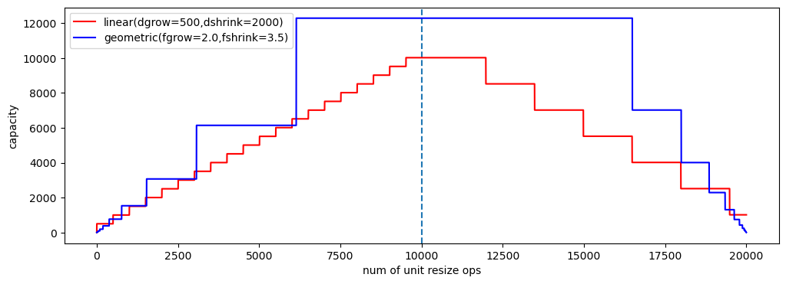

# Lab `dynamic-arrays`: array dinamici

1. **Implementazione C di array dinamici**: Studio e integrazione funzionalità
    - **Studiare** il sorgente `dynamic-arrays.c`, in particolare:
        - si compili (e.g. `gcc -Wall dynamic-arrays.c`) ed **esegua** il codice (e.g. `./a.out` o `.\a.exe` su Windows) e si cerchi di comprendere l'output: per ogni test viene stampato l'esito (`[PASS]` o `[FAIL]`, con i dettagli dei controlli falliti) e alla fine un riepilogo; inizialmente alcuni test falliscono perché sfruttano funzioni **ancora da implementare**.
        - si noti l'uso di una rappresentazione stringa `[size/capacity]{ a_0, ..., a_{n-1} }` per gli array dinamici 
        - si noti l'**invariante** della struttura dati: `0 <= size <= capacity`; le posizioni da `0` a `size-1` contengono gli elementi, quelle da `size` a `capacity-1` sono spazio libero
        - a questo punto si studi il sorgente, e si osservino le funzioni rilevanti, tra cui: `darray_create_capac`, `darray_print`, `darray_realloc`, `darray_resize` (che delega alla politica di ridimensionamento in uso, `darray_resize_linear` o `darray_resize_geometric`), `darray_set_linear_policy`, `darray_set_geometric_policy`, `darray_assert_equals` (usata dai test per confrontare un array dinamico con un array "tradizionale")
        - si noti che ogni ridimensionamento può spostare in memoria gli elementi (`realloc`): i puntatori a elementi dell'array ottenuti prima di un ridimensionamento non sono più validi dopo; per lo stesso motivo, un `DArray` va passato per puntatore e mai copiato
    - **Completare il sorgente implementando le seguenti funzioni**:
        - **`darray_append`**: atta ad aggiungere alla fine dell'array un elemento (ridimensionando l'array)
        - **`darray_insert`**: atta ad aggiungere alla posizione indicata un nuovo elemento (traslando opportunamente quelli attualmente presenti); le posizioni valide vanno da `0` a `size` inclusa (inserire in posizione `size` equivale ad aggiungere in fondo)
        - **`darray_remove`**: atta a rimuovere l'elemento alla posizione indicata e a restituirlo (traslando opportunamente quelli successivi e ridimensionando l'array, il che può ridurne la capacità); le posizioni valide vanno da `0` a `size-1`
        - **`darray_init(size, value)`**: che crea un nuovo array dinamico inizializzando i `size` elementi al valore `value`
        - si verifichino le precondizioni (posizioni valide) con `assert`, come in `darray_set`
    - Si notino le funzioni di test `test_*`, ciascuna dedicata a un'operazione, che `run_tests()` esegue con entrambe le politiche di ridimensionamento dell'array (lineare e geometrica)
        - a differenza di `assert`, che termina il programma alla prima violazione (ed è adatta alle precondizioni, come in `darray_set`), i controlli dei test (`CHECK` e `darray_assert_equals`) segnalano il fallimento e lasciano proseguire: così il riepilogo finale elenca tutti i test che falliscono, e il programma termina con codice di uscita `0` solo se passano tutti
    - Nota: si compili con `gcc -DDEBUG dynamic-arrays.c`, ovvero con opzione **`-DDEBUG`** per attivare log di debug (stampati su `stderr`) e ispezionare il comportamento delle funzioni di riallocazione
    - **Domanda**: `darray_set_linear_policy` e `darray_set_geometric_policy` accettano solo parametri tali che `1 <= GROWING_DELTA < SHRINKING_DELTA` e `1 < GROWING_FACTOR < SHRINKING_FACTOR`. Perché? Cosa succederebbe, ad esempio, con `GROWING_FACTOR = 4` e `SHRINKING_FACTOR = 2` durante una sequenza di `darray_append`? (Suggerimento: si consideri la capacità subito dopo una riallocazione.)
2. *OPZIONALE.* Si consideri il notebook fornito **`plotting_darray_capacity_expansion.ipynb`**, che utilizza `matplotlib` per graficare come evolve la capacità (memoria allocata) di un array dinamico utilizzando le due tecniche di espansione (lineare e geometrica). 
    - Implementare la logica di espansione/contrazione lineare e geometrica, con le stesse regole di `darray_resize_linear` e `darray_resize_geometric`
    - Parametrizzare il codice rispetto ai delta, fattori, soglie di crescita/contrazione
    - Si cerchi di riprodurre una figura tipo la seguente

