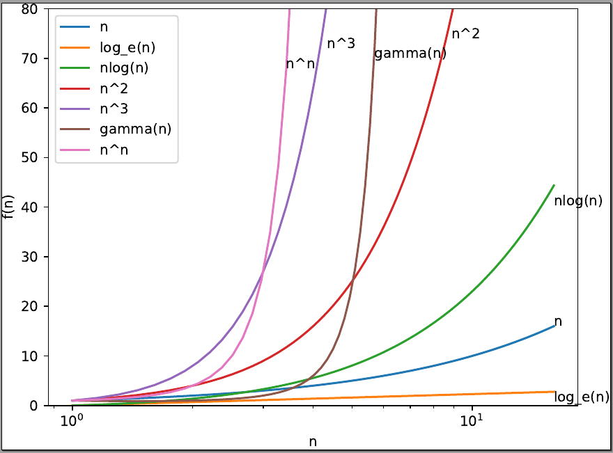
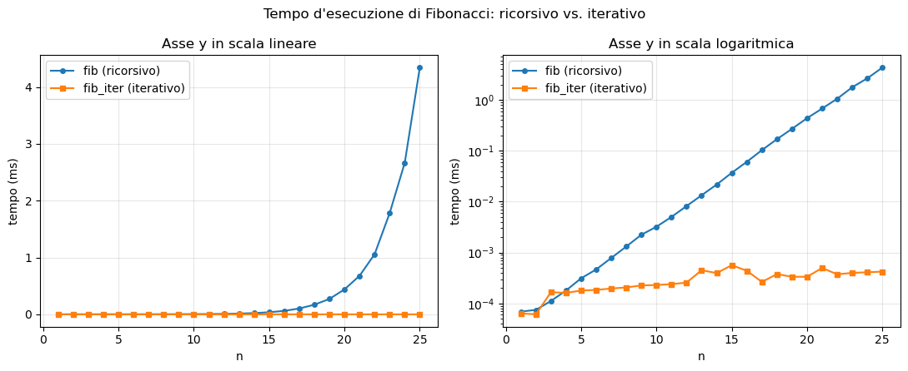

# Lab `plotting`: grafici di funzioni e di tempi d'esecuzione

**Razionale/obiettivi:** acquisire familiarità con funzioni di diverse classi di complessità, e imparare a **graficare dati** per ottenere rappresentazioni utili allo studio e all'indagine.

Svolgere i seguenti esercizi, leggendo attentamente le istruzioni.

1. *[Tempo stimato: 45']* Si utilizzi `matplotlib` per costruire un'immagine simile a quella sottostante
    * Si faccia riferimento alle slide, al notebook [`../../notebooks/matplotlib.ipynb`](../../notebooks/matplotlib.ipynb), agli **esempi** inclusi in [`../../code-python/mpl/`](../../code-python/mpl/)
        * oltre che al [cheatsheet](https://matplotlib.org/cheatsheets/cheatsheets.pdf), alla [guida](https://matplotlib.org/stable/users/explain/quick_start.html), e alla [API Reference](https://matplotlib.org/stable/api/index.html) 
    * Si parta dal file `plot_functions_of_n.py`
    * Alcune indicazioni:
        * Si può stabilire una lista di funzioni da graficare con: `functions = [float, math.log, lambda n: n*math.log(n), ...]`
        * Si può usare `x_points = np.linspace(...)` per individuare i valori dell'asse `x` da produrre
        * Si può produrre le ordinate dei punti da graficare per ogni funzione con qualcosa del tipo:
        `y_points = np.array([some_function(x) for x in x_points])`
        * Si può plottare con `plot(x_points, y_points)`
        * Si può voler limitare l'asse y mediante la funzione `ylim(min,max)`
        * Si può usare `Axes#set_xscale("log")` per impostare una scala logaritmica sull'asse x 
        * Si può usare `Axes#text(x,y,s)` per posizionare un'etichetta con testo `s` al punto `(x,y)` del grafico
        * Si può usare `list(map(f,l))` per produrre una lista applicando `f` ad ogni elemento della lista `l`. Un'alternativa con NumPy potrebbe essere: usare `fvec = np.vectorize(f)` per ottenere una funzione `fvec` che usi `f` per lavorare su array in modo member-wise (cf. broadcasting).
        * Al posto della funzione fattoriale, si può considerare la funzione [gamma](https://en.wikipedia.org/wiki/Gamma_function), che è una generalizzazione del fattoriale su valori reali. In Python: `math.gamma()`

2. *[Tempo stimato: 45']* Si utilizzi `matplotlib` per graficare il **tempo d'esecuzione** di `fib` (Fibonacci in versione ricorsiva) e `fib_iter` (Fibonacci in versione iterativa) **al variare di `n`**, ottenendo un'immagine simile a quella sottostante
    * Si parta dal file `plot_fib_times.py`, che contiene già le due funzioni (le stesse del lab `time`)
    * Si completi la funzione `measure_ms(f, n_times, n_repeats)`, che restituisca il tempo d'esecuzione di `f()` in *millisecondi* (cf. `measure_timeit` nel lab `time`)
    * Si misurino i tempi delle due funzioni per `n` da 1 a 25 (attenzione: valori molto più grandi rendono `fib` molto lenta), e li si grafichi nella stessa figura con due curve distinte, con titolo, etichette degli assi e legenda
    * Si producano due grafici affiancati: uno con l'asse y in scala lineare e uno con l'asse y in **scala logaritmica**
    * Si salvi la figura in `gen/fib_times.pdf`
    * Alcune indicazioni:
        * Si può usare `fig, (ax1, ax2) = plt.subplots(1, 2, figsize=(11, 4.5))` per creare una figura con due grafici affiancati
        * Si può usare `Axes#plot(x, y, marker="o", label="...")` per evidenziare i punti misurati
        * Si può usare `Axes#set_yscale("log")` per impostare una scala logaritmica sull'asse y
        * Si può usare `Axes#set_title(s)` e `Figure#suptitle(s)` per i titoli del singolo grafico e della figura
    * DOMANDE:
        * Nel grafico in scala lineare, si riesce ad apprezzare l'andamento di `fib_iter`? Perché?
        * Che forma assume la curva di `fib` nel grafico in scala logaritmica? Cosa ci dice sulla sua complessità?

## Soluzioni

- `plot_functions_of_n.py`
    - La variabile `X` corrisponde ai diversi input delle funzioni (nel caso di algoritmi, sarebbero le dimensioni `n` del problema di cui vogliamo ottenere le misure)
    - Per ognuna delle funzioni da plottare in `functions`, generiamo i valori prodotti per ogni input: nelle soluzioni, questo viene fatto applicando la funzione scelta `f` a tutti gli elementi di `X` (la chiamata `np.frompyfunc(f, 1, 1)(X)` dà proprio questo, così come `map(f,X)`: cf. punto successivo)
    - **`map(f,X)` vs. `np.frompyfunc` vs. `np.vectorize`, e le ufunc.** Le funzioni in `functions` (es. `math.log`, `math.gamma`, `float`) lavorano su *scalari*: `math.log(X)` su un array solleva `TypeError`. Serve quindi un modo per applicarle elemento per elemento:
        - `np.array(list(map(f, X)))`: soluzione in Python "puro"; `map` restituisce un iteratore *lazy*, che va materializzato con `list` e poi convertito in array; itera solo sulla prima dimensione (su una matrice, `f` riceverebbe le righe) e non fa broadcasting
        - `np.frompyfunc(f, nin, nout)`: costruisce una vera **ufunc** NumPy (`isinstance(..., np.ufunc)` è `True`) a partire da una funzione Python con `nin` input e `nout` output, e ne eredita il comportamento: lavora element-wise su array di qualsiasi forma, con broadcasting, e offre i metodi delle ufunc (es. `np.frompyfunc(lambda a,b: a+b, 2, 1).reduce(arr)`, `.accumulate`, `.outer`). Però restituisce sempre array con `dtype=object` (che contengono oggetti Python): se serve, si converte con `.astype(float)`
        - `np.vectorize(f)`: wrapper di comodo che internamente usa `frompyfunc`, ma *non* è una ufunc (niente `reduce`, `outer`, ...); a differenza di `frompyfunc` produce un array col `dtype` "giusto" (es. `float64`), che però determina chiamando `f` una volta in più sul primo elemento (a meno di indicare `otypes=[float]`); supporta anche `excluded` e `signature` per casi più generali
        - Le ufunc "native" (`np.log`, `np.exp`, `np.sqrt`, gli operatori aritmetici come `X*X`, ...) eseguono il ciclo element-wise in C, su dati a tipo fissato. `frompyfunc` e `vectorize`, invece, chiamano comunque la funzione Python su ogni elemento: offrono l'*interfaccia* di una ufunc, non le sue prestazioni (la documentazione di `vectorize` dice esplicitamente che è "provided primarily for convenience, not for performance"). Indicativamente, su 100.000 punti, `map`, `frompyfunc` e `vectorize` richiedono qualche millisecondo, `np.log(X)` circa 10-20 volte meno
        - Per questo esercizio (100 punti) la differenza è irrilevante; ma, quando possibile, conviene esprimere le funzioni direttamente con ufunc e operazioni NumPy, applicandole a tutto l'array: es. `functions = [lambda n: n, np.log, lambda n: n*np.log(n), lambda n: n**2, ...]` (per la gamma esiste la ufunc `scipy.special.gamma`)
    - Avremo dunque due array `X` e `y`, dove avremo `y[i] = f(X[i])`
    - A quel punto plottiamo `X` e `y` via `axes.plot(X, y)`, dove possiamo fornire una `label` per la legenda
    - Si noti la chiamata `plt.savefig` per salvare il PDF della figura (in `gen/functions.pdf`) che poi verrà mostrata via `plt.show()`
    - La parte forse meno ovvia è quella per posizionare le etichette di testo via `axes.text(x,y,label)`: prima si individua la posizione orizzontale (`idx`) trovando via `argmin()` l'indice nell'array `y` del valore che minimizza la distanza rispetto a `ylimit`, poi si prende con `X[idx]` il punto dell'asse X, e come punto dell'asse Y per l'etichetta o il valore limite (se la funzione lo eccede) oppure l'ultimo valore Y, modificato con un offset per ogni funzione definito in `label_pos`
- `plot_fib_times.py`
    - `measure_ms` usa `timeit.repeat` come nel lab `time`, convertendo il risultato in millisecondi (`* 1000`)
    - le liste `t_rec` e `t_iter` contengono i tempi misurati per ogni `n` in `N` (si noti l'uso di list comprehension)
    - si creano due `Axes` affiancati con `plt.subplots(1, 2)` e si disegnano le stesse curve in entrambi, cambiando solo la scala dell'asse y via `set_yscale`
    - in scala lineare la curva di `fib_iter` è schiacciata sullo zero: i tempi di `fib` crescono così rapidamente da dominare la scala; la scala logaritmica permette invece di confrontare grandezze di ordini diversi
    - in scala logaritmica, la curva di `fib` è (circa) una **retta**: è la firma di un andamento **esponenziale**
    - la curva di `fib_iter` cresce invece lentamente (linearmente in `n`): in scala logaritmica appare quasi piatta e più "rumorosa", perché i tempi sono minuscoli e quindi più sensibili alle fluttuazioni della misura
